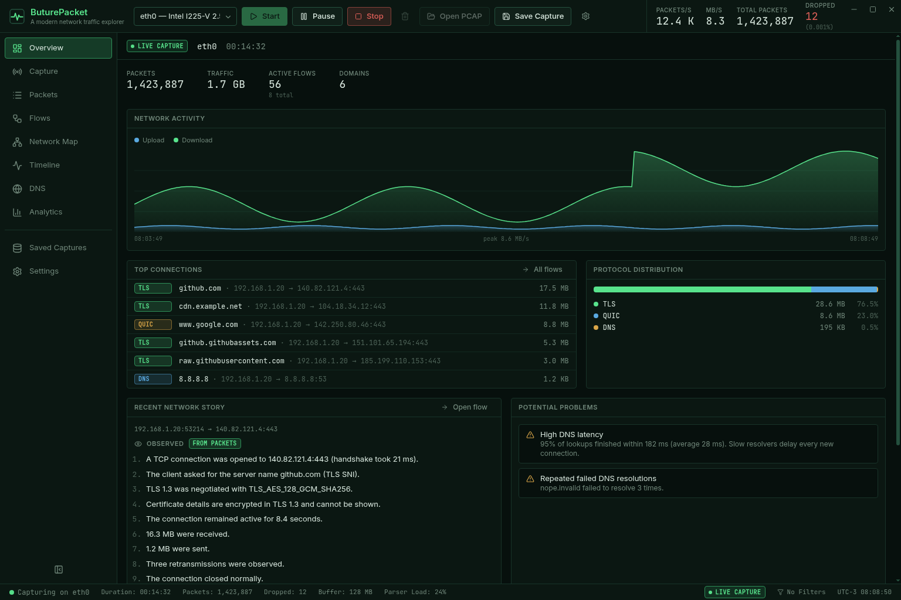
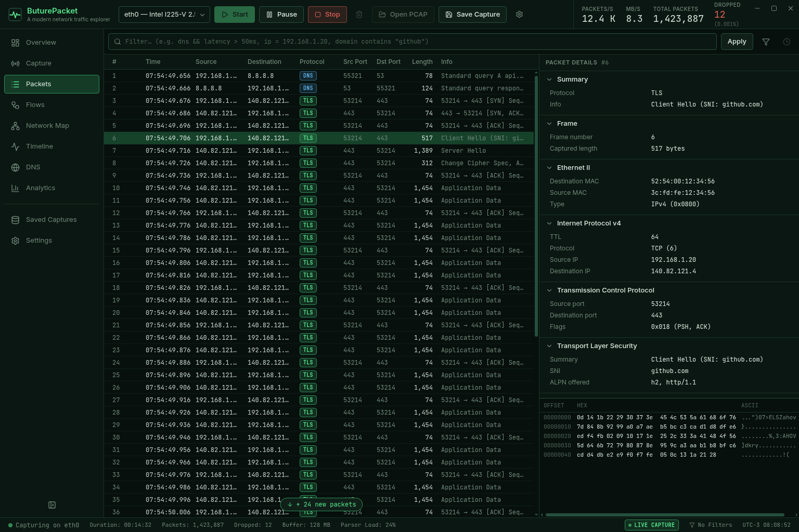
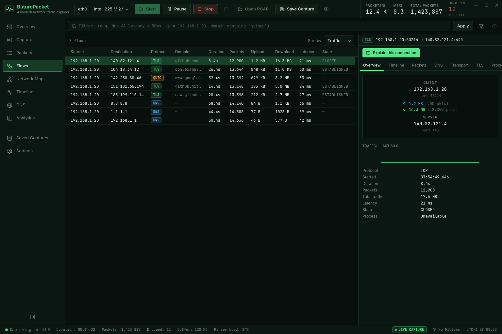
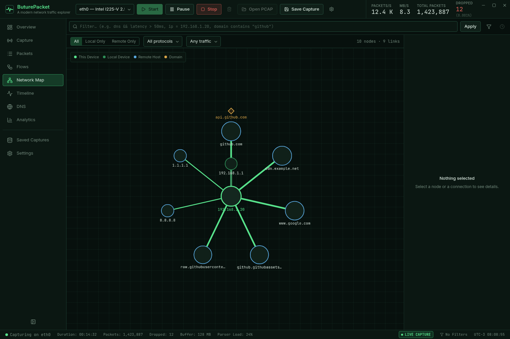
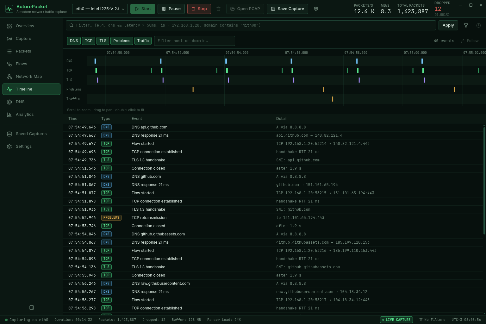
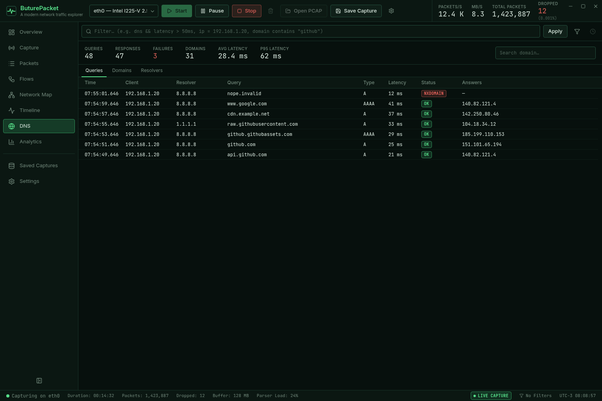
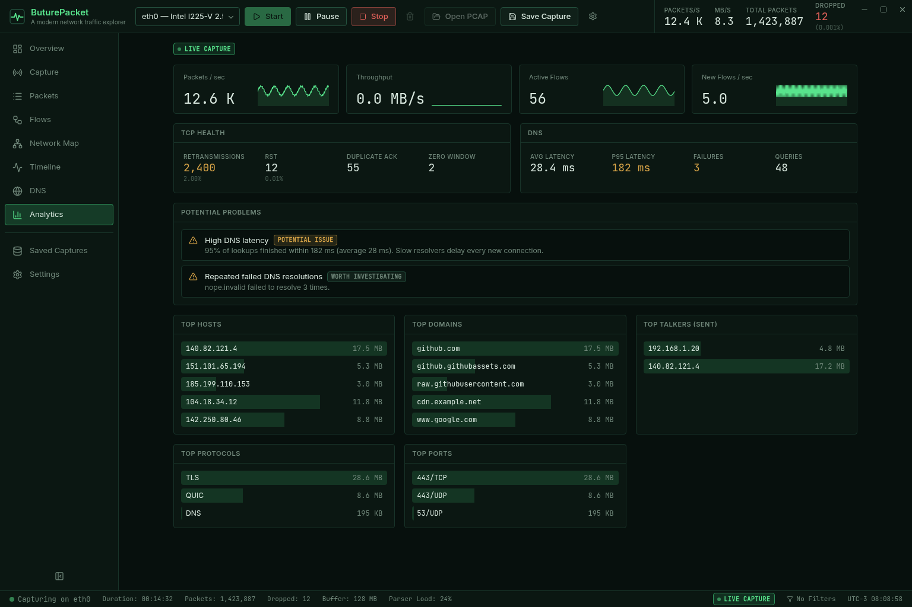
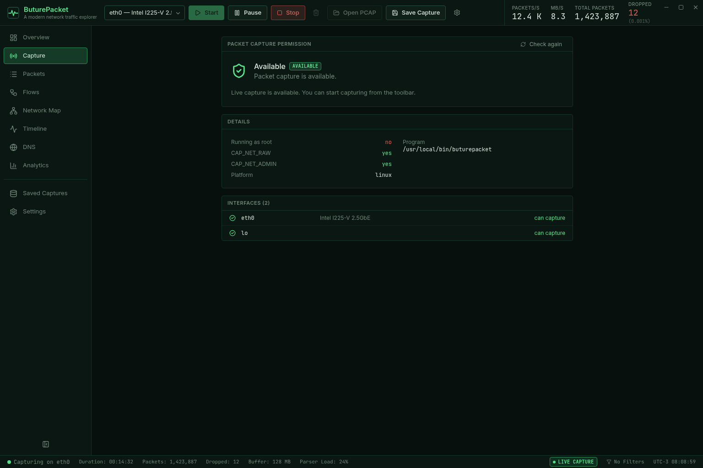

# B&M Packet

`A modern network traffic explorer.`

B&M Packet turns a firehose of packets into something you can read. It captures live traffic (or
opens PCAP/PCAPNG files), groups packets into conversations, correlates DNS, TLS and connection
events, and tells the story of a connection in plain language — keeping what was *observed* clearly
apart from what is only *inferred*.

It is not trying to out-decode Wireshark. The point is to go from "200,000 packets" to "your computer
looked up `api.github.com`, DNS answered in 21 ms, a TLS 1.3 connection moved 18 MB, and there were
three retransmissions" without leaving the app.



<details>
<summary>More screenshots</summary>

| Packets and inspector | Flows |
| --- | --- |
|  |  |

| Network map | Timeline |
| --- | --- |
|  |  |

| DNS | Analytics |
| --- | --- |
|  |  |



*Screenshots are rendered from demo data by `scripts/ui-harness/screenshots.mjs`.*

</details>

## Features

**Capture**
- Live capture through libpcap, or open PCAP / PCAPNG files (drag and drop works). Large files are
  streamed with progress and can be cancelled; they are never loaded whole into memory.
- Ethernet, Linux cooked (`any`), raw IP and loopback link layers.
- Save what you captured as a PCAP.

**Understand**
- **Packets** – virtualized table (hundreds of thousands of rows), keyboard navigation, auto-follow,
  and an inspector that maps every protocol field to its bytes in a hex view.
- **Flows** – bidirectional conversations with direction, volume, latency, TCP state, retransmissions,
  resets and a traffic sparkline.
- **DNS** – queries paired with responses, latency (average and p95), failures, resolvers, and a
  *likely domain* hint for flows (never presented as certain).
- **TLS metadata** – version, SNI, ALPN, cipher suite and certificate details when they travel in the
  clear. Nothing is decrypted; what cannot be seen says *Unavailable*.
- **Network map** – hosts, local devices and domains as a graph with traffic-scaled nodes, filters and
  automatic clustering so thousands of hosts stay readable.
- **Timeline** – DNS, connections, TLS handshakes, retransmissions, resets, latency spikes and
  traffic bursts on zoomable lanes.
- **Network Story** – *Explain this connection* writes the narrative from observed events, with a
  separate, explained list of inferences.
- **Analytics** – packets/s, throughput, active and new flows, TCP health, DNS latency, rankings, and
  careful *potential issue / unusual / worth investigating* findings (never "attack" or "malware").

**Work fast**
- A small filter language (`dns && latency > 50ms`, `ip = 10.0.0.0/8`, `domain contains "github"`) with
  autocomplete, units, CIDR ranges and precise error messages.
- Command palette (`Ctrl+K`), keyboard shortcuts, context menus, resizable panels that remember their
  size.

**Local-first by design** – no account, no cloud, no telemetry, no packet injection. See
[docs/SECURITY.md](docs/SECURITY.md).

## Architecture

```text
React UI
   ↓
Typed Tauri IPC
   ↓
Rust Packet Engine
   ↓
libpcap
   ↓
Network Interface
```

The engine turns packets into understanding in stages:

```text
Packet
↓
Parser            hand-written, bounds-checked decoders (Ethernet, ARP, IPv4/6, TCP, UDP, ICMP, DNS, TLS)
↓
Flow Engine       incremental bidirectional flows, TCP state, retransmission detection
↓
Correlation       DNS ↔ flows, TLS metadata, timeline events
↓
Analytics         per-second metrics, rankings, potential problems
↓
Visualization     tables, inspector, map, timeline, story
```

Packet rows stream to the UI every batch (~50 ms); flow, DNS and event changes are drained four times
a second. A background writer stores derived records (never raw bytes) in SQLite so very large
captures stay searchable. More detail in [docs/ARCHITECTURE.md](docs/ARCHITECTURE.md).

## Stack

| Layer | Technology |
| --- | --- |
| UI | React, TypeScript (strict), Vite, Tailwind CSS, Zustand, TanStack Virtual, Cytoscape.js |
| Desktop shell | Tauri 2 |
| Engine | Rust (2024 edition), libpcap (`pcap` crate), own protocol parsers |
| Storage | SQLite (`rusqlite`, bundled) |

## Security

Captured traffic and capture files are hostile input. Parsers never panic on malformed data (they are
fuzzed), file paths never come from the web view, nothing is executed, privileges are never elevated,
every untrusted string is escaped before display, and every cache and buffer has a bound. The full
review checklist is in [docs/SECURITY.md](docs/SECURITY.md).

## Development

Requirements (Linux): Rust (stable), Node 22+, libpcap development files, the Tauri 2 system
dependencies (WebKitGTK 4.1 etc.). A `mise.toml` pins the toolchains.

```bash
npm install
npm run app:dev        # desktop app with hot reload
npm run dev            # UI only, in a browser (no backend), http://localhost:1431
```

Checks, all of which should pass before committing:

```bash
npm run check          # typecheck + eslint + vitest
npm run build          # production frontend bundle
cd src-tauri
cargo fmt --check
cargo clippy --all-targets -- -D warnings
cargo test
```

Performance probes and the synthetic traffic generator are described in
[docs/PERFORMANCE.md](docs/PERFORMANCE.md). `scripts/ui-harness` drives the UI headlessly for
screenshots and frame-time measurements.

## Build

```bash
npm run app:build      # release build; bundles depend on the platform tools installed
cd src-tauri && cargo build --release   # just the binary: target/release/buturepacket
```

## Linux permissions

Reading packets needs permission from the OS. B&M Packet never asks for your password and never
runs `sudo`. Open **Capture** in the sidebar to see whether capture is *Available*, *Limited* or
*Unavailable*, and why. The usual one-time fix, which you run yourself, grants the capture
capabilities to the binary:

```bash
sudo setcap cap_net_raw,cap_net_admin=eip /path/to/buturepacket
```

Opening PCAP/PCAPNG files needs no special permission.

## Keyboard shortcuts

| Shortcut | Action |
| --- | --- |
| `Ctrl+K` | Command palette |
| `Ctrl+O` | Open a capture file |
| `Ctrl+L` | Focus the filter |
| `Space` | Pause / resume capture |
| `Esc` | Close the current overlay |
| `J` / `K` or `↑` / `↓` | Next / previous packet or row |
| `Enter` | Open the inspector for the selected packet |
| `Ctrl+1` … `Ctrl+8` | Overview, Capture, Packets, Flows, Map, Timeline, DNS, Analytics |
| `Ctrl+B` | Toggle the sidebar |
| `Tab` | Accept a filter suggestion |
| `?` | Show all shortcuts |

## Limitations

- **Tested on Linux only** (Arch-based, Wayland). Other platforms are not claimed to work; the code
  avoids Linux-only assumptions where it can, but it has not been run elsewhere.
- Protocol coverage is deliberately narrow: Ethernet, ARP, IPv4/IPv6, TCP, UDP, ICMP/ICMPv6, DNS
  (A/AAAA/CNAME/PTR) and TLS metadata. QUIC and HTTP are recognised by port only.
- TLS is never decrypted. In TLS 1.3 the certificate and chosen ALPN are encrypted and show as
  *Unavailable*. Handshake metadata needs the handshake bytes in order and within 32 KiB.
- TCP analysis (retransmissions, duplicate ACKs) is heuristic; where the capture was taken affects it.
  The app says "observed", not "caused by".
- The packet list keeps at most 1,000,000 rows. Flows, DNS, timeline and analytics cover the whole
  capture; older raw packets age out of memory on very long captures (saving tells you).
- Process attribution (which program owns a flow) is not implemented yet.
- IP fragments are detected but not reassembled.

## Roadmap

- Page the packet list from the capture database so the 1M-row cap disappears.
- Process attribution for local flows.
- IP/TCP reassembly for HTTP and more reliable TLS handshakes.
- More protocols (DHCP, mDNS, QUIC initial packets, HTTP/1.1 and HTTP/2 headers).
- Capture filters (BPF) applied in the kernel to cut load on busy links.
- Saved sessions with their analysis, and diffing two captures.
- Other platforms, once they have actually been tested.

## License

B&M Packet is an authorial project. **No license is granted**: the source is not released under an
open-source or any other license, and all rights are reserved by the author.
